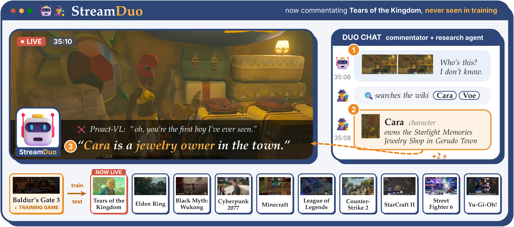

<p align="center">
  
</p>

<h3 align="center">A Live Commentator and a Research Agent for Unseen Games</h3>

<p align="center">
  <a href="https://scholar.google.com/citations?user=Ku5ijSIAAAAJ">Zixian Gao</a><sup>1,2,§</sup> ·
  Penghao Luo<sup>3</sup> ·
  <a href="https://openreview.net/profile?id=~Xiangcheng_Cao1">Xiangcheng Cao</a><sup>1</sup> ·
  <a href="https://lixsp11.github.io/">Zhen Li</a><sup>1,2,§</sup> ·
  <a href="https://riishin.github.io/">Lixin Xiu</a><sup>2</sup> ·
  <a href="https://caiziqi.com/">Ziqi Cai</a><sup>1,4,5,§</sup> ·
  <a href="https://strdb.s.isct.ac.jp/html/100004513_en.html">Erwin Wu</a><sup>5</sup> ·
  <a href="https://scholar.google.com/citations?user=4OqZBmYAAAAJ">Kaipeng Zhang</a><sup>1,†</sup>
</p>

<p align="center">
  <sup>1</sup>Alaya Lab &nbsp; <sup>2</sup>The University of Tokyo &nbsp; <sup>3</sup>Georgia Institute of Technology &nbsp;
  <sup>4</sup>Peking University &nbsp; <sup>5</sup>Institute of Science Tokyo
  <br>
  <sub>§ Work done during an internship at Alaya Lab &nbsp;&nbsp; † Corresponding author</sub>
</p>

<p align="center">
  
  <a href="https://zixiangao.github.io/StreamDuo/static/StreamDuo.pdf"></a>
  <a href="https://zixiangao.github.io/StreamDuo/"></a>
</p>

<p align="center">
  
</p>

---

A trainable commentator (LiveCC-7B-Base) watches the stream and decides every second whether to speak. When it
sees something it cannot name, it asks a frozen research agent (Qwen3-VL-8B with BM25 search over the game's
wiki) by sending the current frames, and the answer arrives two seconds later while the stream continues. The
commentator is trained on Baldur's Gate 3 only and tested on ten games it has never seen.

This repository contains only what is needed to train and test that system.

## Layout

```
streamduo/
  data/       Proact-VL splits, clean test protocol, K/V/S labels for K-strict
  wiki/       wiki snapshot (MediaWiki API) and entity ontology per game
  research/   the research agent that writes a game dossier before the stream
  interact/   training answers, information-gain ask labels, test-time answer cache of the research agent
  model/      the commentator (response head + ask head), training (Stage 0 / 1), streaming inference
  train/      Stage 2: on-policy self-distillation, LoRA merge
  eval/       TimeDiff, F1, Ent-R, Ent-F1, K-strict, source-game leakage, LLM judge
scripts/      one script per step, in order
configs/      DeepSpeed ZeRO-3, splits, wiki sources
```

## Setup

Two Python 3.11 environments:

```bash
pip install -r requirements-train.txt   # training, inference, metrics (PY_TRAIN)
pip install -r requirements-vllm.txt    # research agent and LLM server (PY_VLLM)
```

Set the paths at the top of `scripts/env.sh` (`STREAMDUO_DATA`, `PY_TRAIN`, `PY_VLLM`, `NGPU`). All data,
checkpoints and results live under `$STREAMDUO_DATA`. Training uses 4 GPUs with 80 GB each.

Data: the Proact-VL game commentary data (`oaaoaa/game_commentary_sft`, `oaaoaa/LiveGamingBenchmark`, gated on
the Hugging Face Hub) and `chenjoya/LiveCC-7B-Base`:

```bash
HF_TOKEN=hf_... python scripts/0_download.py
```

Steps that call a text LLM (cleaning, dossiers, judge) use an OpenAI-compatible server, by default a local vLLM
server with Qwen3-30B-A3B started by `scripts/serve_llm.sh`. Point them to it with
`STREAMDUO_LLM_BASE_URL` and `STREAMDUO_LLM_MODEL`.

## Usage

Run the scripts in [`scripts/`](scripts/) in order, from `1_data.sh` (data, wiki, dossiers) to `8_eval.sh`
(metrics). [`scripts/README.md`](scripts/README.md) lists what each step produces, together with the training and
inference settings.

## Citation

```bibtex
@article{streamduo2026,
  title  = {StreamDuo: A Live Commentator and a Research Agent for Unseen Games},
  author = {Gao, Zixian and Luo, Penghao and Cao, Xiangcheng and Li, Zhen and Xiu, Lixin and Cai, Ziqi and Wu, Erwin and Zhang, Kaipeng},
  year   = {2026}
}
```
